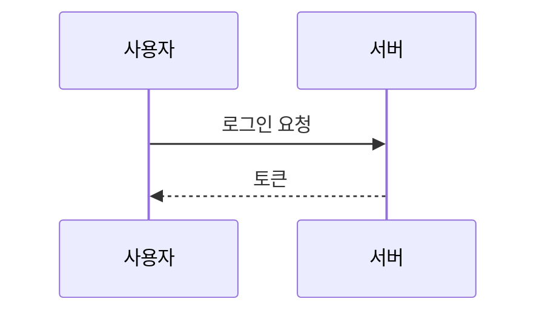
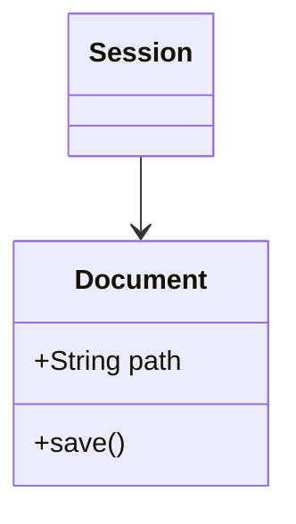
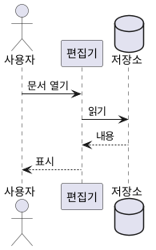
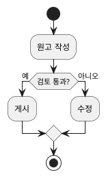

# 다이어그램 · 수식 플러그인 샘플

미리보기(Split/Preview)를 열고 **Extended** 또는 **SuperMarkdown** 파서에서 확인한다.

| 플러그인 | 코드 블록 언어 | 로컬 렌더링 | 서버 렌더링 |
|---|---|---|---|
| Mermaid | `mermaid` | 앱에 내장된 mermaid.js (모든 다이어그램 종류) | Kroki `mermaid` |
| PlantUML | `plantuml`, `puml` | 설치된 `plantuml` 또는 `plantuml.jar` (Java 필요) | Kroki `plantuml` |
| D2 | `d2` | 설치된 `d2` | Kroki `d2` |
| draw.io | `drawio` | 앱 내장 렌더러 (압축/비압축 XML) | — |
| LaTeX 수식 | `$…$`, `$$…$$` | 앱 내장 MathML | — |

> [!NOTE] 렌더링 방식 설정 (설정 → General → Diagrams)
> - **Diagram Rendering**: `Local tools, then server`(기본) · `Local tools only` · `Diagram server only`
>   - 기본값은 로컬 도구로 먼저 그리고, 도구가 설치되어 있지 않을 때만 서버를 쓴다.
>   - 로컬 도구가 다이어그램 문법 오류를 보고하면 서버로 보내지 않고 오류를 그대로 표시한다.
> - **Diagram Server**: kroki.io 또는 `Off`. 사내 Kroki 서버는 settings.json의 `preview.diagramServer`에 지정한다.
>   서버를 쓰면 해당 다이어그램 소스가 서버로 전송된다.
> - **PlantUML Command / D2 Command**: 예) `plantuml`, `C:\tools\plantuml.jar`, `java -jar "C:\Program Files\plantuml.jar"`, `d2`
> - **Check Local Tools** 버튼으로 설치 여부와 버전을 확인한다.
>
> Mermaid의 flowchart·sequence 다이어그램은 전체 렌더링이 끝나기 전까지 간이 렌더러의 그림을 먼저 보여 준다.

## 1. Mermaid

### Flowchart


### Sequence



### Class diagram (mermaid.js 또는 서버)



## 2. PlantUML





## 3. D2

```d2
direction: right
editor: 편집기 {shape: rectangle}
preview: 미리보기
plugins: 플러그인 {shape: cylinder}
editor -> preview: 렌더링
preview -> plugins: 다이어그램 요청
plugins -> preview: SVG
```

## 4. draw.io

### 비압축 XML (draw.io에서 File → Export as → XML, "Compressed" 해제)

```drawio
<mxfile>
  <diagram name="Page-1">
    <mxGraphModel>
      <root>
        <mxCell id="0"/>
        <mxCell id="1" parent="0"/>
        <mxCell id="start" value="시작" style="ellipse;fillColor=#dae8fc;strokeColor=#6c8ebf;" vertex="1" parent="1">
          <mxGeometry x="0" y="40" width="100" height="50" as="geometry"/>
        </mxCell>
        <mxCell id="check" value="검토?" style="rhombus;fillColor=#fff2cc;strokeColor=#d6b656;" vertex="1" parent="1">
          <mxGeometry x="160" y="30" width="110" height="70" as="geometry"/>
        </mxCell>
        <mxCell id="done" value="게시" style="rounded=1;whiteSpace=wrap;html=1;fillColor=#d5e8d4;strokeColor=#82b366;" vertex="1" parent="1">
          <mxGeometry x="340" y="40" width="100" height="50" as="geometry"/>
        </mxCell>
        <mxCell id="fix" value="수정" style="rounded=0;fillColor=#f8cecc;strokeColor=#b85450;dashed=1;" vertex="1" parent="1">
          <mxGeometry x="165" y="150" width="100" height="40" as="geometry"/>
        </mxCell>
        <mxCell id="e1" style="endArrow=classic;" edge="1" parent="1" source="start" target="check">
          <mxGeometry relative="1" as="geometry"/>
        </mxCell>
        <mxCell id="e2" value="예" style="endArrow=classic;" edge="1" parent="1" source="check" target="done">
          <mxGeometry relative="1" as="geometry"/>
        </mxCell>
        <mxCell id="e3" value="아니오" style="endArrow=classic;strokeColor=#b85450;" edge="1" parent="1" source="check" target="fix">
          <mxGeometry relative="1" as="geometry"/>
        </mxCell>
        <mxCell id="e4" style="endArrow=classic;dashed=1;" edge="1" parent="1" source="fix" target="start">
          <mxGeometry relative="1" as="geometry">
            <Array as="points">
              <mxPoint x="50" y="170"/>
            </Array>
          </mxGeometry>
        </mxCell>
      </root>
    </mxGraphModel>
  </diagram>
</mxfile>
```

### 압축 XML (draw.io 기본 저장 형식)

```drawio
<mxfile><diagram name="Page-1">xZPBboMwDIafxvfUaVGvK1172kMEYiBaIMgJLbz9NMhaEO20SZN2i/3rd+wvMci07s+s2urNabIgX0Gm7FyYTnWfkrWAwmiQR0AUgAh4eqJuRlW0iqkJPzGoyXBRtqMpk7q6ZfKe9CT5MNgosesaTZ/ODchDYaxNnXU8ilLvaK+3IA8+sHunmbLHTCYJyEO8izhQ/7TfMRWbPZOrKfAAKPr5NGJYRFejQxXdX7mKTFnFktuYU36Ky1vZOxnAU4TzGFS2AnU0qmRVryiRtab1tCZUFAXm+SNCOsmS3R8RQvFvjGjNotEvzO4K8phb5b3Jb0OSLun7EVF413FOi58aFJcUZm+yBsFkVTCXZfVfzAV4ui/gqC328wM=</diagram></mxfile>
```

## 5. LaTeX 수식

인라인: $e^{i\pi} + 1 = 0$, $\sin^2\theta + \cos^2\theta = 1$, $x_{1,2} = \frac{-b \pm \sqrt{b^2-4ac}}{2a}$,
$\mathbb{R}^n$, $\mathcal{L}$, $\mathfrak{g}$, $\vec{v} \cdot \hat{n}$, $\binom{n}{k}$, $a \not= b$, $\text{if } x > 0$.

극한·합·적분 (디스플레이에서는 첨자가 위·아래로 간다):

$$
\lim_{n \to \infty} \left(1 + \frac{1}{n}\right)^n = e
\qquad
\sum_{k=1}^{n} k = \frac{n(n+1)}{2}
\qquad
\int_0^\infty e^{-x^2}\,dx = \frac{\sqrt{\pi}}{2}
$$

행렬:

$$
A = \begin{pmatrix} 1 & 2 & 3 \\ 4 & 5 & 6 \end{pmatrix},\quad
\det\begin{vmatrix} a & b \\ c & d \end{vmatrix} = ad - bc,\quad
I = \begin{bmatrix} 1 & 0 \\ 0 & 1 \end{bmatrix}
$$

경우 나누기:

$$
|x| = \begin{cases} x & \text{if } x \ge 0 \\ -x & \text{otherwise} \end{cases}
$$

정렬된 식:

$$
\begin{aligned}
f(x) &= (x+1)^2 \\
     &= x^2 + 2x + 1
\end{aligned}
$$

강조와 장식:

$$
\boxed{E = mc^2} \quad \overbrace{a+b+c}^{\text{합}} \quad \underbrace{x \cdot y}_{\text{곱}} \quad \color{red}{\nabla \times \mathbf{B}} = \mu_0 \mathbf{J}
$$

오류 표시(알 수 없는 명령): $\unknowncommand{x}$
