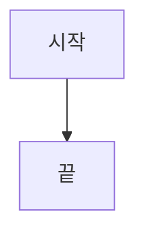

# {{title}} v{{version}} [#sec:top]

이 문서는 Markdown Super Set 파서의 모든 문법을 한 번에 확인하기 위한 샘플이다.
미리보기 도구 막대의 파서 선택에서 **Markdown Super Set**을 고른 뒤 확인한다.

[TOC depth=2]

## 1. 제목 [#sec:headings]

### 명시 ID가 있는 제목 [#custom-id]

### 자동 ID 제목

Setext 제목 1단계
=================

Setext 제목 2단계
-----------------

제목 링크: [명시 ID로 이동](#custom-id), 상호 참조: [#sec:headings]

## 2. 강조와 텍스트 서식

- 기울임: *별표*, _밑줄_
- 굵게: **별표**, __밑줄__
- 중첩: ***굵은 기울임***
- 취소선: ~~지운 글~~
- 아래첨자: H~2~O, 위첨자: x^2^ + y^2^
- 밑줄 span: [밑줄 텍스트]{.underline}
- 하이라이트: ==중요한 부분==
- 이스케이프: \*별표 아님\*, \# 샵, snake_case_name 은 기울임이 아니다.

## 3. 목록

1. 첫째
2. 둘째
   - 중첩 항목
   - 또 다른 항목
3. 셋째

시작 번호를 지정한 목록:

5. 시작 번호 5
6. 다음 번호

- [ ] 할 일
- [/] 진행 중
- [x] 완료
- [X] 대문자 완료
- [-] 취소

용어 A
: 용어 A의 정의다.

용어 B
: 첫 번째 정의
: 두 번째 정의

(@first) 첫 번째 예제.
(@second) 두 번째 예제.

예제 (@first)과 (@second)를 참조한다.

## 4. 코드

인라인 `code`와 이중 백틱 ``a ` b``.

    들여쓰기 코드 블록
    두 번째 줄

```python caption="예시 코드" label=lst:hello
print("hello")
```

```{=latex}
\newpage
```

코드 참조: [#lst:hello]

## 5. 인용, 콜아웃, 줄바꿈

> 인용문이다.
>> 중첩 인용문이다.

> [!NOTE] 메모 콜아웃
> 내용은 **일반 마크다운**으로 쓴다.

> [!TIP]+ 펼친 상태로 시작
> 접을 수 있다.

> [!warning]- 접힌 상태로 시작
> 숨겨진 내용.

> [!NOTE] 바깥
> > [!TIP] 안쪽
> > 중첩 콜아웃 내용

행 끝 백슬래시로\
강제 줄바꿈, 공백 두 칸으로  
강제 줄바꿈.

---

<!-- pb -->

## 6. 링크와 이미지

- 인라인 링크: [MarkEdit](https://markedit.app "MarkEdit 홈")
- 참조 링크: [참조 링크][ref], [ref][]
- 자동 링크: <https://example.com>, URL 자동 인식: https://example.com/path_with_underscores?a=1&b=2
- 위키링크: [[다른 문서]], [[다른 문서|별칭]], [[문서#제목]], [[문서#^block1]]
- 이미지: {width=50%}
- 이미지 임베드: ![[image.png|300]]
- 위험한 링크는 무시된다: [클릭](javascript:alert(1))

[ref]: https://example.com/reference "참조 제목"

## 7. 표

| 구분 | 측정 | < |
|---|---|---|
| 속도 | 1회차 | 10 |
| ^ | 2회차 | 12 |
| 메모리 | 1회차 | 256 |
[Table: 셀 병합 표] [#tbl:merge]

| 좌측 | 가운데 | 우측 |
|:---|:---:|---:|
| a | b | c |
| `a \| b` | \^ 이스케이프 | \< |

| 작업 | 상태 |
|---|---|
| 설계 | [x] |
| 구현 | [/] |
| 테스트 | [ ] |
| 폐기 | [-] |

+---------------+---------------+
| 과일          | 설명          |
+===============+===============+
| 바나나        | - 노란색      |
|               | - 달다        |
+---------------+---------------+
| 사과          | 빨갛다        |
+---------------+---------------+

표 참조: [#tbl:merge]

## 8. 수식, 각주, 인용, 메타데이터

인라인 수식 $E = mc^2$, 그리고 `%%` 가 수식 안에서는 주석이 아니다: $a %% b$.
행렬과 경우 나누기: $\begin{pmatrix} a & b \\ c & d \end{pmatrix}$, $f(x) = \begin{cases} 1 & x > 0 \\ 0 & \text{otherwise} \end{cases}$.

$$
E = mc^2
$$ [#eq:energy]

식 [#eq:energy]에 따라 질량은 에너지와 같다.

각주 참조[^1]와 긴 각주[^long].

[^1]: 짧은 각주다.

[^long]: 첫 문단이다.

    둘째 문단은 4칸 들여쓰기로 쓴다.

인용 참조: [@doe2020; @smith2021], 그리고 본문 속 @knuth1984 인용. 이메일 user@example.com 은 인용이 아니다.

## 9. 원시 HTML, 주석

<div class="note-box" onclick="alert(1)">
  <strong>HTML 블록</strong> — onclick 속성은 제거된다.
</div>

인라인 <span style="color: tomato">HTML span</span>과 <kbd>Ctrl</kbd>+<kbd>C</kbd>.

<script>alert('실행되지 않는다')</script>

<!-- 렌더링되지 않는 주석 -->

이 문장 안에 %%보이지 않는 주석%%이 있다.

%%
여러 줄 주석
%%

## 10. 노트 연결

#태그 는 행 시작이라 태그가 아니지만, 문장 속 #태그 와 #project/sub 는 태그다. #123 은 숫자뿐이라 태그가 아니다.

이 문단은 블록 참조 ID를 가진다. ^block1

## 13. 실행 청크

```{python run label=calc caption=계산 예시}
#| echo: true
#| output: true
print(1 + 2)
```

```python
# 정적 코드: 실행하지 않는다
print("static")
```

## 14. 다이어그램 청크



```{mermaid render caption="렌더링 청크" label=fig:flow}
#| echo: true
graph LR
A --> B --> C
```

```{plantuml render caption="로그인 흐름" label=fig:login}
@startuml
Alice -> Bob: 요청
Bob --> Alice: 응답
@enduml
```

```{=mermaid}
graph TD
X --> Y
```

```{d2 render caption="D2 구성도" label=fig:d2}
#| echo: false
editor -> preview -> plugins
```

```drawio caption="draw.io 다이어그램" label=fig:drawio
<mxGraphModel><root><mxCell id="0"/><mxCell id="1" parent="0"/>
<mxCell id="a" value="편집기" style="rounded=1;fillColor=#dae8fc;strokeColor=#6c8ebf;" vertex="1" parent="1"><mxGeometry x="0" y="0" width="100" height="40" as="geometry"/></mxCell>
<mxCell id="b" value="미리보기" style="ellipse;fillColor=#d5e8d4;strokeColor=#82b366;" vertex="1" parent="1"><mxGeometry x="180" y="0" width="110" height="40" as="geometry"/></mxCell>
<mxCell id="e" value="렌더링" style="endArrow=classic;" edge="1" parent="1" source="a" target="b"><mxGeometry relative="1" as="geometry"/></mxCell>
</root></mxGraphModel>
```

그림 참조: [#fig:flow], [#fig:login], [#fig:d2], [#fig:drawio]

더 많은 다이어그램·수식 예제는 `diagrams-and-math.md` 샘플을 참고한다.

## 16. 펜스 div와 조건부 블록

:::{.warning title=주의}
펜스 div 안의 **마크다운**.
:::

:::{.only-html}
HTML에서만 보이는 내용
:::

:::{.only-latex}
PDF에서만 보이는 내용 (미리보기에서는 숨겨진다)
:::

## 26. 탭 블록

::::{.tabset}
:::{.tab title=Python}
```python
print("hi")
```
:::
:::{.tab title=R}
```r
print("hi")
```
:::
::::

## 27. 파일 포함

@include chapters/intro.md

## 29. 키보드 키

저장은 [Ctrl]+[S], 취소는 [Esc]를 누른다. [F5]로 새로고침.

## 오류 표시 확인

정의되지 않은 참조 [#fig:none], 정의되지 않은 변수 {{missing}}.
