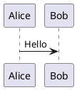

# gsync Markdown Syntax Reference

This document summarizes the Markdown syntax interpreted by gsync. It is based on the gsync repository's source code and documentation.

| Table: analysis target |||
|---|---|---|
| **Location** | **Role** |
| `vendor/mdparser/*.go` | Markdown parser core (blocks, inline, tables, containers, definition lists, footnotes) |
| `internal/converter/cfstorage/*.go` | Pre- and post-processing (Front Matter, `@import`, math, abbreviations, diagrams, MPE tables, alerts, metadata) |
| `internal/renumber/renumber.go` | Heading and caption numbering rules |
| `docs/GSYNC-MANUAL.md`, `README.md` | User documentation |
| `internal/scaffold/templates/docs/MAN-WRITING-GUIDELINE.md` | Writing conventions |

> [!IMPORTANT] Difference between documentation and implementation
>
> The manual describes a goldmark-based GFM, but the current code uses a custom parser `mdparser` (`replace mdparser => ../mdparser` in go.mod). This document is written **based on the code**. Differences from the manual are collected in "11. Differences between the manual and the implementation, and cautions".

---

## 1. Processing Order

Interactions between syntaxes are determined by processing order. The Confluence upload path (`ConvertMarkdownToHTMLWithAssets`) works in this order:

1. Extract and remove inline metadata comments (`<!-- Key: value -->`)
2. Remove YAML/TOML Front Matter
3. Recursive `@import` expansion (max depth 20)
4. Extract math (`$$…$$`, `$…$` → placeholders)
5. Extract abbreviation definitions (`*[ABBR]: …`)
6. Parallel diagram pre-rendering
7. `mdparser` parsing (soft line break = `br`, auto heading IDs, footnotes, definition lists enabled)
8. Diagram code blocks → PNG `` substitution
9. Math restoration (`\(…\)`, `\[…\]`) → later LaTeX → SVG conversion
10. Abbreviations → `<abbr>` application
11. MPE table post-processing (captions, colspan, rowspan)
12. GitHub Alert → Confluence macro

The HTML/PDF export path (`ConvertMarkdownToHTMLForExport`) performs steps 1, 5, 10. Instead it applies chroma syntax highlighting (`github` style) to code blocks and converts alerts to HTML callouts.

---

## 2. Document Header

### 2.1. YAML Front Matter

From the first line's `---` to the next `---` or `...` line is treated as Front Matter and removed from the body. UTF-8 BOM is allowed. All gsync settings go under the `GSYNC:` key.

```yaml
---
GSYNC:
  server:
    type: confluence          # confluence (default) | codebeamer
  confluence:
    parentPageId: "334008853"
    projectCode: "MYPROJ"
    coupleFile: ".\\manual-kr.md"
    tabLabel: "English"
    imageLimitWidth: 600
    pageHierarchy:
      enabled: false
      parentLevel: "h2"
  git: { ... }
  pdf: { ... }
---
```

Front Matter of `.md` files included via `@import` is also removed. So each chapter file can carry its own Front Matter without polluting the body.

### 2.2. Inline Metadata Comments

Immediately after Front Matter, before the body begins, one-line HTML comments specify upload behavior. Format borrowed from the mark tool (kovetskiy/mark). Keys are case-insensitive; blank lines may appear between them. Scanning stops at the first non-metadata line, and recognized lines are removed from the body.

```markdown
<!-- Space: MYSPACE -->
<!-- Title: My Page Title -->
<!-- Parent: Parent Page Title -->
<!-- Label: documentation -->
<!-- Attachment: files/spec.pdf -->
<!-- Section: 7 -->
<!-- Content-Appearance: full-width -->
<!-- No-Delete: true -->
<!-- Hierarchy: h2 -->
<!-- Hierarchy-Rule: section=^7\. API; parent=h2; child=h3; create-parent=true -->
```

| Key | Repeat | Meaning |
|---|---|---|
| `Space` | once | Override Confluence space key |
| `Title` | once | Override top-level page title |
| `Parent` | multiple | Page hierarchy (outermost first, last is direct parent) |
| `Label` | multiple | Add label to all uploaded pages |
| `Attachment` | multiple | Specify attachment files |
| `Section` | once | Section number/slug hint |
| `Content-Appearance` | once | `full-width` (default) or `fixed` |
| `No-Delete` | once | `true` protects from `--allow-delete` |
| `Hierarchy` | once | Heading level for page split; enables hierarchy split when set |
| `Hierarchy-Rule` | multiple | Per-section split rule |

`Hierarchy-Rule` is a `;`-separated list of `key=value` pairs.

| Parameter | Meaning |
|---|---|
| `section` | Regex for the target H2 heading |
| `name` | Rule label (optional) |
| `parent` | Parent level (e.g., `h2`) |
| `child` | Child level (e.g., `h3`, or `h3,h4` → child and grandchild pages) |
| `create-parent` | If `true`, create a separate page for the parent content |

Sub-headings are split into child pages only when they start with the parent chapter number prefix (e.g., `7.`).

### 2.3. Fixed Page ID

A `page-id` comment inside a section keeps the same Confluence page even when the heading changes. The recognized pattern is `page-id:\s*(\d+)` (case-insensitive).

```markdown
## 3. My Section
<!-- page-id: 123456789 -->
```

---

## 3. Document Structure and Headings

### 3.1. ATX Headings

Supports `#` through `######` (H1–H6). A space or tab is required after `#`. Trailing `#` characters are removed. Setext headings (`===`, `---` underlines) are **not** supported.

| Level | Usage |
|---|---|
| H1 | Document title. Used for the TOC page. Only one |
| H2 | Chapter. Confluence page split unit. CodeBeamer item creation starts at this level |
| H3 and below | Sections/subsections. Can be split into child pages via `pageHierarchy`/`Hierarchy-Rule` |

Content before the first H2 is included in the first section.

### 3.2. Heading Attributes and IDs

An attribute block `{…}` can be appended to a heading (see section 6). If no ID is specified, an auto ID is assigned. Auto IDs are created by lowercasing, keeping letters and digits (including Korean), replacing spaces, `-`, `_` with `-`, and removing other symbols. Empty result becomes `heading`. All headings get a `data-heading-level` attribute.

```markdown
## 3. Product Overview {#overview .chapter}
```

### 3.3. Heading Numbering Convention

Chapter/section numbers use dotted hierarchical numbers followed by a period. `gsync renumber` reorders numbers based on this format.

```markdown
## 3. Chapter Title
### 3.1. Section Title
#### 3.1.1. Subsection Title
```

---

## 4. Block Syntax

Blocks are judged in this priority order: blank line → HTML comment → fenced code → container/`???` → ATX heading → horizontal rule → quote → unordered list → ordered list → `Table:` caption line → GFM table → raw HTML block → paragraph.

### 4.1. Paragraphs and Line Breaks

Paragraphs are separated by blank lines. gsync uses soft line break mode `br`, so **simple line breaks inside a paragraph are also rendered as `<br>`**. Hard breaks written with two trailing spaces or `\` are also `<br>`.

An attribute block can be placed at the end of a paragraph. However, `{…}` immediately after a link or image ending in `)` is treated as that link/image's attribute.

```markdown
This is an emphasized paragraph. {.lead}
```

### 4.2. Horizontal Rule

Three or more of `-`, `*`, `_` (spaces allowed between).

```markdown
---
```

### 4.3. Blockquote

Lines starting with `>` are collected. Non-empty lines without `>` are included as lazy continuation. **A completely empty line ends the quote.** To split paragraphs inside a quote, use a line with only `>`.

```markdown
> First paragraph
>
> Second paragraph
```

### 4.4. Lists

| Type | Marker |
|---|---|
| Unordered list | `-`, `*`, `+` followed by space |
| Ordered list | `number.` followed by space (`1)` form not supported). If the first number is not 1, a `start` attribute is added |
| Task list | Item content starts with `[ ]`, `[x]`, `[X]` |

- A marker line indented deeper becomes a nested list. Ordered and unordered lists can be mixed when nesting.
- Plain lines indented deeper than the marker become continuation lines of the item.
- An item ends when encountering a blank line, fence, heading, horizontal rule, quote, container, HTML block, or comment. So **code blocks, quotes, and tables cannot be placed inside a list item.**
- Depth rendering: unordered lists cycle `data-marker` through `disc` → `circle` → `square` → `hollow-square`. Ordered lists cycle `type` from depth 1 as `A` → `a` → `I` → `i`.

```markdown
- [x] Completed item
- [ ] Incomplete item
  1. Nested ordered list (type="A")
```

### 4.5. Fenced Code Blocks

Three or more ```` ``` ```` or `~~~`. Leading indentation (up to 3 spaces) is stripped from content too. The closing fence must use the same character and be at least as long. Indented (4-space) code blocks are not supported.

The info string format is:

```text
<lang> [key="value" ...] [{#id .class key=value}]
```

- The first token is the language.
- `key="value"` pairs become metadata. The key `title` is primary.
- A trailing `{…}` attribute block is also merged into metadata. So MPE style `` ```c{title="…"} `` is recognized.

````markdown
```c title="Code 5-1: SEEDKEY_RT Enumeration"
typedef enum { SEEDKEY_SUCCESS = 0 } SEEDKEY_RT;
```
````

| Target | Result |
|---|---|
| Confluence | `code` macro. `language`, `title`, `linenumbers=true`, theme `Confluence` |
| HTML/PDF export | chroma syntax highlighting, `<code data-title="…">` |
| CodeBeamer | wiki markup code block |

Diagram languages (`plantuml`, `puml`, `dot`, `graphviz`) are converted to images per "9.1. Diagrams".

### 4.6. Tables (GFM)

A header row followed by a separator row (`|---|:--:|--:|`) is recognized as a table. Alignment is determined by `:` position (left `:---`, center `:---:`, right `---:`). Body rows end at a blank line or a line without `|`. The `|` character inside a cell is escaped as `\|`.

An attribute block `{…}` alone on the line after the table is applied to `<table>`.

```markdown
| Item | Value |
|:---|---:|
| A | 1 |
{.compact #tbl-api}
```

MPE extensions (captions, merging) are in "4.7. MPE Extended Tables"; inline cell syntax is in "4.8. Extended Syntax Inside Table Cells".

### 4.7. MPE Extended Tables

#### 4.7.1. Captions

Captions can be specified three ways. Priority is top to bottom. In Confluence the caption renders as a bold paragraph above the table (`<p><strong>…</strong></p>`).

| Method | Format |
|---|---|
| HTML comment (recommended, renumber target) | `<!-- table title="Table 5-1: API Files" -->` immediately above the table (single quotes also allowed) |
| Caption line | A line `Table: …` immediately above the table (blank line allowed; only English `Table:` is recognized) |
| MPE caption row | First cell of the header row starts with `Table…:` or `표…:` |

MPE caption rows recognize `Table:`, `Table 5.1:`, `Table 12.2.3-1:`, `표:`, `표 5-1:`. When a caption row is used, that row is removed and the first body row is promoted to the header row (`<th>`). So column titles are conventionally written in bold in the first body row.

```markdown
| Table 5-1: API Files |||
|---|---|---|
| **Item** | **Filename** | **Description** |
| Server | HKMC_ASK_Server.a | Server library |
```

#### 4.7.2. Cell Merging

| Marker | Behavior |
|---|---|
| `>` | If cell content is only `>`, merge with the cell to the left (colspan increases) |
| Trailing empty cells | Consecutive empty cells at the end of a row (`\| A \|\|\|`) are merged into the last non-empty cell (implicit colspan) |
| `^` | If cell content is only `^`, merge with the cell above (rowspan increases) |

```markdown
| A | > | > |
| B | C | D |
| ^ | E | F |
```

Merging applies only to body (`<tbody>`) rows. To keep a cell intentionally empty, put `&nbsp;` in it; a cell with `&nbsp;` is treated as non-empty.

### 4.8. Extended Syntax Inside Table Cells

Cell content is split by `<br>` into lines and the following syntax is interpreted.

| Syntax | Result |
|---|---|
| `- item`, `* item` | Unordered list |
| `1. item` | Ordered list |
| `- [x] item`, `- [ ] item` | Task list |
| `---` (alone on a line) | Internal separator `<hr class="cell-sep">` |
| `\- item`, `\1. item` | Output literally, not as a list |
| Other lines | Plain text, separated by `<br>` |

```markdown
| Item | Content |
|---|---|
| Settings | - Option A <br> - Option B <br> --- <br> Note text |
```

**Nested table (Bang table):** If every line in a cell starts and ends with `!`, and the second line is a separator row, it becomes a nested table. The separator is `!` instead of `|`, and the separator row needs 3+ dashes. If the cell contains an image (`![`), it is not interpreted. If the format is broken, the original text is output with `<!-- nested-table parse warning -->`.

```markdown
| API | Parameters |
|---|---|
| Init | ! Name ! Type ! <br> ! --- ! --- ! <br> ! id ! int ! |
```

### 4.9. Containers (`:::`)

Opens with `::: <type> [title] [{attrs}]` and closes with `:::`. Can be nested. Result is `<div class="container container-<type>">`, with `<div class="container-title">` prepended when a title is given.

```markdown
::: warning Pre-deploy check {#pre-deploy}
Body is normal markdown.
:::
```

**Code tabs:** When the type is `code-tabs`, each `@tab <title>` line starts a new tab.

````markdown
::: code-tabs
@tab C
```c
int x = 0;
```
@tab Python
```python
x = 0
```
:::
````

> [!CAUTION] Upload target support
>
> Containers and code tabs are emitted as generic HTML (`div`, `button`, `section`). There is no step that converts them to Confluence macros, so the uploaded appearance depends on Confluence's HTML handling.

### 4.10. Foldable Blocks (`???`)

MkDocs-style foldable blocks. Open with `??? [type] "title"` or `???+ …`, content indented 4 spaces (or 1 tab). Result is `<details class="admonition admonition-<type>"><summary>title</summary>…</details>`. If the type is omitted it becomes `details`; if the title is omitted the type name becomes the title. The current implementation does not distinguish the expanded state for `???+`.

```markdown
??? note "See details"
    Folded content
```

### 4.11. Definition Lists

If the line after a term (one blank line allowed) starts with `: ` or `~ `, it becomes a definition list. Fenced code is not touched.

```markdown
Term
:   Definition content
```

### 4.12. Footnotes

`[^id]` in the body becomes a superscript link, and `[^id]: content` written as a paragraph is collected into the footnotes section at the end of the document. `[^id]` inside code is not converted.

```markdown
Body uses a footnote reference[^1].

[^1]: Footnote content goes here.
```

### 4.13. Raw HTML and HTML Comments

- If a line starts with block tags such as `div`, `table`, `pre`, `p`, `ul`, `ol`, `dl`, `details`, `summary`, `section`, `figure`, `header`, `footer`, `nav`, the original text is output verbatim up to the next blank line.
- A line starting with `<!--` passes through as a comment up to `-->`. Metadata comments and `<!-- table title="…" -->` are handled specially.
- The verification-criteria comment `<!-- 검증 기준 (Verification Criteria): Review -->` is used for requirement field classification on CodeBeamer upload and removed from the body. Allowed values: `Review`, `Test`, `Analysis`, `N/A`.

---

## 5. Inline Syntax

Inline elements are processed in this order. Content protected by an earlier step is not changed by later steps.

| Order | Syntax | Result |
|---|---|---|
| 1 | `` `code` `` | `<code>`, protected from further processing |
| 2 | `\*`, `\_`, `\[`, `\|`, `\$`, etc. | Backslash escape, output as literal character |
| 3 | `{attrs}` | `` |
| 4 | `[text](url "title"){attrs}` | `<a>` |
| 5 | `[[target]]`, `[[target#anchor]]`, `[[target\|Label]]` | Wikilink `<a class="wiki-link">` |
| 6 | `@ref(id)` | Cross-reference `<a href="#id" class="cross-ref">` |
| 7 | `~~text~~` | `<del>` |
| 8 | `***text***`, `___text___` | `<strong><em>` |
| 9 | `**text**`, `__text__` | `<strong>` |
| 10 | `*text*`, `_text_` | `<em>` (ignored inside words for `_`) |
| 11 | `<https://…>` | Autolink |
| 12 | Bare `https://…` | Autolink |
| 13 | `user@example.com` | `mailto:` link |
| 14 | `...`, `---`, `--` | `&hellip;`, `&mdash;`, `&ndash;` (typography substitution) |

### 5.1. Images

```markdown
{width=480 .shadow}
{caption="auth flow"}
```

- The `width` attribute sets the display width. Confluence applies the smaller of the explicit width and the actual width, capped by `imageLimitWidth` (default 600px).
- `caption=` is used as the title when there is no title.
- On Confluence upload, the alt text becomes the image caption (`<ac:caption>`). Generic words such as `image`, `figure`, `diagram`, `plantuml` are not used as captions.
- Supported formats: PNG, JPEG, GIF, SVG, WebP. `data:image/…;base64,…` is also decoded into an attachment file.

### 5.2. Links

```markdown
[Link text](https://example.com "title"){.external target=_blank}
```

Reference-style links (`[text][ref]` with `[ref]: url`) are not supported.

### 5.3. Wikilinks and Cross-References

- `[[page]]` links to `page.html`. If the target contains `/` or `.`, no extension is added. `#anchor` becomes a slug. `[[toc]]` is not converted.
- `@ref(id)` links to `#id` in the same document. Heading IDs follow the rule in "3.2. Heading Attributes and IDs".

---

## 6. Attribute Blocks `{…}`

Tokens separated by spaces inside braces. Spaces inside quotes are preserved.

| Token | Meaning |
|---|---|
| `#id` | `id` |
| `.class` | Add class (repeatable) |
| `key=value`, `key="value with space"` | General attribute |
| `flag` | `flag="true"`; output without a value if it is a boolean HTML attribute |

| Location | Example |
|---|---|
| End of heading | `## Title {#id .cls}` |
| End of paragraph | `Paragraph text {.note}` |
| End of fence info | `` ```c {title="…" .wide} `` |
| Line after table | `{.compact}` |
| Right after image/link | `{width=300}` |
| End of container opening line | `::: tip Title {#id}` |

---

## 7. Math (LaTeX)

| Syntax | Kind |
|---|---|
| `$…$` | Inline math (within a line) |
| `$$…$$` (single line) | Display math |
| `$$` … `$$` on their own lines | Block display math (indented delimiter lines allowed) |
| `\(…\)`, `\[…\]` | Recognized directly at the HTML stage |

Math is protected as placeholders before Markdown parsing. So `*`, `_` inside math are not interpreted as emphasis. Rendering needs `latex` and `dvisvgm`; the result is an SVG data URL image. If the tools are missing or rendering fails, the original text is output as-is.

```markdown
The energy formula is $E = mc^2$.

$$
\int_{0}^{\infty} e^{-x^2} dx = \frac{\sqrt{\pi}}{2}
$$
```

---

## 8. GitHub-Style Alerts

A blockquote whose first paragraph starts with `[!TYPE]` becomes an alert. Case-insensitive; inner spaces such as `[! NOTE ]` are allowed.

```markdown
> [!NOTE] Section split rule
>
> The document is split into individual Confluence pages based on H2 headings.
```

| Alert | Confluence macro | Export HTML |
|---|---|---|
| `[!NOTE]` | `info` | `div.gh-alert.gh-alert-note` |
| `[!TIP]` | `tip` | `div.gh-alert.gh-alert-tip` |
| `[!IMPORTANT]` | `note` | `div.gh-alert.gh-alert-important` |
| `[!WARNING]` | `warning` | `div.gh-alert.gh-alert-warning` |
| `[!CAUTION]` | `warning` | `div.gh-alert.gh-alert-caution` |

- The marker is removed, and the type name (e.g. `NOTE`) is inserted as a bold title at the top of the macro.
- A title written after the marker (e.g. `Section split rule`) remains as the first line of the body (not bold).
- In the PDF path it becomes a bold quote title: `> **[NOTE]** title`.

The legacy emoji note convention (`> **📄[NOTE] title**`, `> **📣[CAUTION] title**`) is treated as a regular quote. It is not converted to a Confluence macro.

---

## 9. gsync Extensions

### 9.1. Diagrams

| Language | Tool | Result |
|---|---|---|
| `plantuml`, `puml` | PlantUML (`GSYNC_PLANTUML_PATH`, auto-discovered `plantuml.jar`, etc.) | PNG image |
| `dot`, `graphviz` | Graphviz (`GSYNC_GRAPHVIZ_PATH`) | PNG image |
| `mermaid` | No rendering path currently | Left as code block (see "11. Differences between the manual and the implementation, and cautions") |

- A fence with `title="…"` gets a centered italic caption below the image: `<p style="text-align: center;"><em>…</em></p>`.
- Image file names are derived from the H2 section number prefix and content hash: `<section-prefix>plantuml-<hash>.png`. Identical content is not re-rendered.
- Image width is set to the actual PNG width.

````markdown

````

### 9.2. Abbreviations

PHP Markdown Extra compatible syntax. Definition lines are removed from output, and matching words in the body are wrapped in `<abbr title="…">`. Matching uses word boundaries (`\b`); longer abbreviations match first. Text inside HTML tags is not changed. Redefining the same abbreviation keeps only the first definition.

```markdown
*[HTML]: HyperText Markup Language
*[API]: Application Programming Interface
```

### 9.3. `@import`

A line starting with `@import "path"` is replaced by the file contents. The path is relative to the current file. `@import` inside fenced code is ignored. Maximum recursion depth is 20. A missing file leaves `<!-- @import failed: path -->`. BOM is stripped from imported files.

| Extension | Handling |
|---|---|
| `.md`, `.markdown` | Remove Front Matter, then recursively preprocess and inline |
| `.html`, `.htm` | Insert as raw HTML |
| `.csv` | Convert to a Markdown table (first row is header) |
| Others (`.py`, `.c`, etc.) | Wrap in a code fence using the extension as language |

```markdown
@import "chapter2.md"
@import "data.csv"
@import "example.py"
```

### 9.4. Tab Pages (Multilingual)

Using Front Matter `coupleFile` and `tabLabel`, plus the `-tab` flag, sections of the paired file are merged by index. Each section is wrapped in Confluence `ui-tabs`/`ui-tab` macros. This is a configuration feature, not a syntax feature; details follow the gsync manual "10. Tab Pages".

---

## 10. Caption and Numbering Rules (`gsync renumber`)

`renumber` renumbers headings and captions. Caption number format is `chapter-sequence`. The chapter number comes from the `## N.` heading; per-type sequence numbers restart at 1 for each chapter. Diagram figures and image figures share the same sequence.

| Type | Korean | English |
|---|---|---|
| Table | `<!-- table title="표 N-M: …" -->` | `<!-- table title="Table N-M: …" -->` |
| Code | `` ```lang title="코드 N-M: …" `` | `` ```lang title="Code N-M: …" `` |
| Figure (diagram) | `` ```plantuml title="그림 N-M: …" `` | `` ```plantuml title="Figure N-M: …" `` |
| Figure (image) | `` | `` |

- The colon after the number is optional.
- Existing number formats (`5-3`, `5.3`, `11.1.2-1`, `11.1.2 - 1`, `5-2 - 2`) are all normalized to `chapter-sequence`.
- Code fence captions are recognized regardless of language, including `` ```c{title="…"}`` form and quotes (`> ```c title="…"`).
- Uncaptioned image captions ``, `` get a new number.
- MPE caption rows (`| Table N-M: … |||`) are **not** renumbered. Use `<!-- table title="…" -->` when numbering is needed.
- The gsync conversion process does not auto-number captions. Numbers are written by hand or fixed by `renumber`.
- Skipping heading levels (e.g., H2 → H4) produces a warning.

---

## 11. Differences between the Manual and the Implementation, and Cautions

| Item | Content |
|---|---|
| Parser | The manual says goldmark-based, but the actual parser is the custom `mdparser`. Not fully compatible with CommonMark/GFM |
| Mermaid | The manual and README say it is supported, but the current Markdown path's diagram substitution handles only `plantuml`/`puml`/`dot`/`graphviz`. `mermaid` fences remain as code blocks |
| Math and code | Math extraction does not skip fenced code. Two `$` on one line inside a code block (e.g., shell `$HOME/$USER`) can become math |
| Abbreviations and code | Abbreviation definition extraction also does not skip fenced code. `*[X]: …` at the start of a line is removed even inside code |
| Abbreviations in export path | HTML/PDF export does not process abbreviations. Definition lines remain as text in the body |
| Typography | `--`, `---`, `...` outside inline code become dashes and ellipsis. CLI options written in the body (`--verbose`) must be wrapped in backticks |
| Soft line breaks | All line breaks inside a paragraph become `<br>`. A sentence split across lines renders on separate lines |
| Quotes and blank lines | A completely empty line ends the quote. Use a `>`-only line to split paragraphs inside a quote |
| Blocks inside lists | Code blocks, quotes, and tables cannot be placed inside a list item. A blank line ends the list |
| Unsupported syntax | Setext headings, indented code blocks, reference-style links, `1)` ordered list markers |
| Include directives | `mdparser` has code for `!include(…)`, `!import(…)`, `@[include](…)` but it is never called. Only `@import "…"` (double quotes, at line start) actually works |
| Caption lines | A standalone caption line above a table recognizes only English `Table:`. `표:` is recognized only in MPE caption rows |
| Heading levels | `renumber` handles up to `#######` (H7), but the parser recognizes headings only up to H6 |
| Containers, tabs, foldables | Supported by the parser but not documented in the manual. Uploaded output depends on Confluence's HTML handling because there is no macro conversion |

---

## 12. Writing Conventions (summary of MAN-WRITING-GUIDELINE)

Conventions recommended by the gsync scaffold's writing guideline. The parser does not enforce them.

- Headings: one `#` document title, `##` chapter, `###` section, `####` subsection, `#####` item. All chapters and sections get `N.M.` numbers.
- Document control comments: place `<!-- Hierarchy: … -->`, `<!-- Hierarchy-Rule: … -->` right after Front Matter.
- Tables: use a caption row, write column titles in bold in the first body row. Use `<br>` for line breaks inside cells and `&nbsp;` for indentation.
- Code blocks: always specify the language and add a caption with `title="Code N-M: …"`.
- Diagrams: prefer PlantUML → Mermaid → Graphviz. Note that the current implementation does not render Mermaid.
- Notes and cautions: write `> [!NOTE] title` / `> [!CAUTION] title`, then `>` on the next line, then the content. Titles are noun phrases of 10 characters or fewer.
- Cross-references: use the quoted "section-number - heading" form, e.g. `"12.1.1 - Basic Function Test"`.