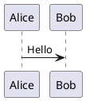

# gsync Markdown 문법 정리

이 문서는 gsync가 해석하는 Markdown 문법을 정리한다. 근거는 gsync 저장소의 소스 코드와 문서이다.

| Table: 분석 대상 ||
|---|---|
| **위치** | **역할** |
| `vendor/mdparser/*.go` | Markdown 파서 본체 (블록·인라인·표·컨테이너·정의 목록·각주) |
| `internal/converter/cfstorage/*.go` | 전처리와 후처리 (Front Matter, `@import`, 수식, 약어, 다이어그램, MPE 표, Alert, 메타데이터) |
| `internal/renumber/renumber.go` | 헤딩·캡션 번호 규칙 |
| `docs/GSYNC-MANUAL.md`, `README.md` | 사용자 문서 |
| `internal/scaffold/templates/docs/MAN-WRITING-GUIDELINE.md` | 작성 관례 |

> [!IMPORTANT] 문서와 구현의 차이
>
> 매뉴얼은 goldmark 기반 GFM이라고 설명하지만, 현재 코드는 자체 파서 `mdparser`를 사용한다 (`go.mod`의 `replace mdparser => ../mdparser`). 이 문서는 **코드 기준**으로 작성했다. 매뉴얼과 다른 부분은 "11. 매뉴얼과 구현의 차이 및 주의점"에 모았다.

---

## 1. 처리 순서

문법끼리의 상호작용은 처리 순서로 결정된다. Confluence 업로드 경로(`ConvertMarkdownToHTMLWithAssets`)는 다음 순서로 동작한다.

1. 인라인 메타데이터 주석 추출 및 제거 (`<!-- Key: value -->`)
2. YAML/TOML Front Matter 제거
3. `@import` 재귀 전개 (최대 깊이 20)
4. 수식 추출 (`$$…$$`, `$…$` → 자리표시자)
5. 약어 정의 추출 (`*[ABBR]: …`)
6. 다이어그램 병렬 사전 렌더링
7. `mdparser` 파싱 (soft line break = `br`, 헤딩 자동 ID, 각주, 정의 목록 활성)
8. 다이어그램 코드 블록 → PNG `` 치환
9. 수식 복원 (`\(…\)`, `\[…\]`) → 이후 LaTeX → SVG 변환
10. 약어 → `<abbr>` 적용
11. MPE 표 후처리 (캡션, colspan, rowspan)
12. GitHub Alert → Confluence 매크로

HTML/PDF export 경로(`ConvertMarkdownToHTMLForExport`)는 1, 5, 10단계를 수행하지 않는다. 대신 코드 블록에 chroma 구문 강조(`github` 스타일)를 적용하고, Alert를 HTML 콜아웃으로 변환한다.

---

## 2. 문서 머리 (Document Header)

### 2.1. YAML Front Matter

파일 첫 줄의 `---`부터 다음 `---` 또는 `...` 줄까지를 Front Matter로 보고 본문에서 제거한다. UTF-8 BOM을 허용한다. gsync 설정은 모두 `GSYNC:` 키 아래에 둔다.

```yaml
---
GSYNC:
  server:
    type: confluence          # confluence (기본) | codebeamer
  confluence:
    parentPageId: "334008853"
    projectCode: "MYPROJ"
    coupleFile: ".\\manual-kr.md"
    tabLabel: "English"
    imageLimitWidth: 600
    pageHierarchy:
      enabled: false
      parentLevel: "h2"
  git: { ... }
  pdf: { ... }
---
```

`@import`로 포함한 `.md` 파일의 Front Matter도 제거된다. 따라서 장(chapter) 파일마다 Front Matter를 두어도 본문에 섞이지 않는다.

### 2.2. 인라인 메타데이터 주석

Front Matter 직후, 본문 시작 전에 한 줄짜리 HTML 주석으로 업로드 동작을 지정한다. 형식은 Mark 도구(kovetskiy/mark)에서 가져왔다. 키는 대소문자를 구분하지 않으며, 빈 줄을 사이에 둘 수 있다. 메타데이터가 아닌 첫 줄을 만나면 스캔을 멈추고, 인식한 줄은 본문에서 제거한다.

```markdown
<!-- Space: MYSPACE -->
<!-- Title: My Page Title -->
<!-- Parent: Parent Page Title -->
<!-- Label: documentation -->
<!-- Attachment: files/spec.pdf -->
<!-- Section: 7 -->
<!-- Content-Appearance: full-width -->
<!-- No-Delete: true -->
<!-- Hierarchy: h2 -->
<!-- Hierarchy-Rule: section=^7\. API; parent=h2; child=h3; create-parent=true -->
```

| Table: 인라인 메타데이터 키 |||
|---|---|---|
| **키** | **반복** | **의미** |
| `Space` | 1회 | Confluence 스페이스 키 재지정 |
| `Title` | 1회 | 최상위 페이지 제목 재지정 |
| `Parent` | 복수 | 상위 페이지 계층 (바깥쪽부터, 마지막이 직접 부모) |
| `Label` | 복수 | 업로드되는 모든 페이지에 라벨 추가 |
| `Attachment` | 복수 | 첨부 파일 명시 |
| `Section` | 1회 | 섹션 번호/슬러그 힌트 |
| `Content-Appearance` | 1회 | `full-width` (기본) 또는 `fixed` |
| `No-Delete` | 1회 | `true`이면 `--allow-delete`에서도 삭제 보호 |
| `Hierarchy` | 1회 | 페이지 분리 기준 헤딩 레벨, 지정 시 계층 분리 활성 |
| `Hierarchy-Rule` | 복수 | 섹션별 분리 규칙 |

`Hierarchy-Rule`은 `;`로 구분한 `key=value` 목록이다.

| Table: Hierarchy-Rule 파라미터 ||
|---|---|
| **파라미터** | **의미** |
| `section` | 적용 대상 H2 제목의 정규식 |
| `name` | 규칙 라벨 (선택) |
| `parent` | 상위 레벨 (예: `h2`) |
| `child` | 하위 레벨 (예: `h3`, 또는 `h3,h4` → 자식·손자 페이지) |
| `create-parent` | `true`면 상위 내용 페이지를 별도로 생성 |

하위 헤딩은 부모 챕터 번호 접두어(예: `7.`)로 시작할 때만 하위 페이지로 분리된다.

### 2.3. 페이지 ID 고정

섹션 안에 `page-id` 주석을 두면 제목이 바뀌어도 같은 Confluence 페이지를 갱신한다. 인식 패턴은 `page-id:\s*(\d+)`이다 (대소문자 무시).

```markdown
## 3. My Section
<!-- page-id: 123456789 -->
```

---

## 3. 문서 구조와 헤딩

### 3.1. ATX 헤딩

`#`부터 `######`까지(H1~H6) 지원한다. `#` 뒤에는 공백이나 탭이 필요하다. 끝에 붙은 `#`은 제거된다. Setext 헤딩(`===`, `---` 밑줄)은 지원하지 않는다.

| Table: 헤딩 레벨의 의미 ||
|---|---|
| **레벨** | **용도** |
| H1 | 문서 제목. TOC 페이지에 사용. 1개만 사용 |
| H2 | 장(chapter). Confluence 페이지 분리 단위. CodeBeamer 아이템 생성 시작 레벨 |
| H3 이하 | 절·소절. `pageHierarchy`/`Hierarchy-Rule`로 하위 페이지 분리 가능 |

첫 H2 이전의 내용은 첫 번째 섹션에 포함된다.

### 3.2. 헤딩 속성과 ID

헤딩 끝에 속성 블록 `{…}`을 붙일 수 있다 ("8. 속성 블록" 참조). ID를 지정하지 않으면 자동 ID가 부여된다. 자동 ID는 소문자화, 문자·숫자 유지(한글 포함), 공백·`-`·`_`를 `-`로 바꾸고 나머지 기호를 제거해 만든다. 결과가 비면 `heading`이 된다. 모든 헤딩에는 `data-heading-level` 속성이 붙는다.

```markdown
## 3. 제품 개요 {#overview .chapter}
```

### 3.3. 헤딩 번호 관례

장·절 번호는 마침표 구분 계층 번호 뒤에 마침표를 붙인다. `gsync renumber`가 이 형식을 기준으로 번호를 재정렬한다.

```markdown
## 3. 챕터 제목
### 3.1. 섹션 제목
#### 3.1.1. 하위 섹션 제목
```

---

## 4. 블록 문법

블록은 아래 우선순위로 판정한다: 빈 줄 → HTML 주석 → 펜스 코드 → 컨테이너/`???` → ATX 헤딩 → 수평선 → 인용 → 순서 없는 목록 → 순서 있는 목록 → `Table:` 캡션 줄 → GFM 표 → Raw HTML 블록 → 문단.

### 4.1. 문단과 줄바꿈

빈 줄로 문단을 구분한다. gsync는 soft line break 모드를 `br`로 사용하므로 **문단 안의 단순 줄바꿈도 `<br>`로 렌더링된다**. 행 끝 공백 2개 또는 `\`로 쓰는 hard break도 `<br>`이다.

문단 끝에 속성 블록을 둘 수 있다. 단, 문단이 `)`로 끝나는 링크나 이미지 바로 뒤의 `{…}`는 그 링크·이미지의 속성으로 처리한다.

```markdown
강조 문단이다. {.lead}
```

### 4.2. 수평선

`-`, `*`, `_` 중 한 문자를 3개 이상 쓴다 (사이 공백 허용).

```markdown
---
```

### 4.3. 인용 (Blockquote)

`>`로 시작하는 줄을 모은다. `>`가 없는 비어 있지 않은 줄은 lazy continuation으로 포함한다. **완전히 빈 줄을 만나면 인용이 끝난다.** 인용 안에서 단락을 나누려면 `>`만 있는 줄을 쓴다.

```markdown
> 첫 단락
>
> 둘째 단락
```

### 4.4. 목록

| Table: 목록 마커 ||
|---|---|
| **종류** | **마커** |
| 순서 없는 목록 | `-`, `*`, `+` 뒤 공백 |
| 순서 있는 목록 | `숫자.` 뒤 공백 (`1)` 형식은 미지원). 첫 번호가 1이 아니면 `start` 속성 부여 |
| 작업 목록 | 항목 내용이 `[ ]`, `[x]`, `[X]`로 시작 |

- 들여쓰기가 더 깊은 마커 줄은 중첩 목록이 된다. 순서 있는/없는 목록을 섞어 중첩할 수 있다.
- 마커보다 깊게 들여쓴 일반 줄은 항목의 연속 줄이 된다.
- 빈 줄, 펜스, 헤딩, 수평선, 인용, 컨테이너, HTML 블록·주석을 만나면 항목이 끝난다. 즉 **목록 항목 안에 코드 블록이나 인용을 넣을 수 없다.**
- 깊이별 렌더링: 순서 없는 목록은 `data-marker`가 `disc` → `circle` → `square` → `hollow-square` 순으로 바뀐다. 순서 있는 목록은 깊이 1부터 `type`이 `A` → `a` → `I` → `i` 순으로 바뀐다.

```markdown
- [x] 완료된 항목
- [ ] 미완료 항목
  1. 중첩된 순서 목록 (type="A")
```

### 4.5. 펜스 코드 블록

```` ``` ```` 또는 `~~~`를 3개 이상 쓴다. 여는 펜스 앞의 들여쓰기(최대 3칸)는 내용에서도 제거한다. 닫는 펜스는 같은 문자로 같은 길이 이상이어야 한다. 들여쓰기(4칸) 코드 블록은 지원하지 않는다.

info 문자열의 형식은 다음과 같다.

```text
<lang> [key="value" ...] [{#id .class key=value}]
```

- 첫 토큰이 언어이다.
- `key="value"` 쌍은 메타데이터가 된다. 핵심 키는 `title`이다.
- 끝의 `{…}` 속성 블록도 메타데이터로 합쳐진다. 그래서 MPE 스타일 `` ```c{title="…"} ``도 인식한다.

````markdown
```c title="Code 5-1: SEEDKEY_RT Enumeration"
typedef enum { SEEDKEY_SUCCESS = 0 } SEEDKEY_RT;
```
````

| Table: 코드 블록 변환 결과 ||
|---|---|
| **대상** | **결과** |
| Confluence | `code` 매크로. `language`, `title`, `linenumbers=true`, 테마 `Confluence` |
| HTML/PDF export | chroma 구문 강조, `<code data-title="…">` |
| CodeBeamer | wiki 마크업 코드 블록 |

다이어그램 언어(`plantuml`, `puml`, `dot`, `graphviz`)는 "9.1. 다이어그램"에 따라 이미지로 바뀐다.

### 4.6. 표 (GFM)

헤더 행 다음 줄이 구분 행(`|---|:--:|--:|`)이면 표로 판정한다. 정렬은 `:`의 위치로 정한다 (왼쪽 `:---`, 가운데 `:---:`, 오른쪽 `---:`). 본문 행은 빈 줄이나 `|`가 없는 줄에서 끝난다. 셀 안의 `|` 문자는 `\|`로 이스케이프한다.

표 다음 줄에 `{…}` 속성 블록만 있으면 `<table>`에 적용한다.

```markdown
| 항목 | 값 |
|:---|---:|
| A | 1 |
{.compact #tbl-api}
```

MPE 확장(캡션, 병합)은 "4.7. MPE 확장 표"에, 셀 안 문법은 "4.8. 표 셀 안의 확장 문법"에 정리했다.

### 4.7. MPE 확장 표

#### 4.7.1. 캡션

캡션은 세 가지 방법으로 지정한다. 우선순위는 위에서 아래 순이다. 캡션은 Confluence에서 표 위의 굵은 문단(`<p><strong>…</strong></p>`)으로 렌더링된다.

| Table: 표 캡션 지정 방법 ||
|---|---|
| **방법** | **형식** |
| HTML 주석 (권장, renumber 대상) | 표 바로 위에 `<!-- table title="Table 5-1: API Files" -->` (작은따옴표도 허용) |
| 캡션 줄 | 표 바로 위 줄에 `Table: …` (빈 줄 허용, 영문 `Table:`만 인식) |
| MPE 캡션 행 | 헤더 행의 첫 셀이 `Table…:` 또는 `표…:`로 시작 |

MPE 캡션 행은 `Table:`, `Table 5.1:`, `Table 12.2.3-1:`, `표:`, `표 5-1:`을 모두 인식한다. 캡션 행이 쓰이면 해당 행은 제거되고, 첫 본문 행이 열 제목 행(`<th>`)으로 승격된다. 따라서 열 제목은 본문 첫 행에 굵게 쓰는 것이 관례이다.

```markdown
| Table 5-1: API Files |||
|---|---|---|
| **항목** | **파일명** | **설명** |
| Server | HKMC_ASK_Server.a | 서버 라이브러리 |
```

#### 4.7.2. 셀 병합

| Table: 셀 병합 마커 ||
|---|---|
| **마커** | **동작** |
| `>` | 셀 내용이 `>`뿐이면 왼쪽 셀과 병합 (colspan 증가) |
| 후행 빈 셀 | 행 끝의 연속된 빈 셀(`\| A \|\|\|`)은 마지막 비어 있지 않은 셀에 병합 (암묵적 colspan) |
| `^` | 셀 내용이 `^`뿐이면 위 셀과 병합 (rowspan 증가) |

```markdown
| A | > | > |
| B | C | D |
| ^ | E | F |
```

병합은 본문(`<tbody>`) 행에만 적용한다. 빈 셀을 의도적으로 유지하려면 `&nbsp;`를 넣는다. `&nbsp;`가 있는 셀은 비어 있지 않은 셀로 간주한다.

### 4.8. 표 셀 안의 확장 문법

셀 내용을 `<br>`로 줄 단위로 나누어 다음 문법을 해석한다.

| Table: 셀 안 문법 ||
|---|---|
| **문법** | **결과** |
| `- 항목`, `* 항목` | 순서 없는 목록 |
| `1. 항목` | 순서 있는 목록 |
| `- [x] 항목`, `- [ ] 항목` | 작업 목록 |
| `---` (한 줄 단독) | 셀 내부 구분선 `<hr class="cell-sep">` |
| `\- 항목`, `\1. 항목` | 목록으로 해석하지 않고 글자 그대로 출력 |
| 그 밖의 줄 | 일반 텍스트, `<br>`로 구분 |

```markdown
| 항목 | 내용 |
|---|---|
| 설정 | - 옵션 A <br> - 옵션 B <br> --- <br> 비고 텍스트 |
```

**중첩 표 (Bang table):** 셀 안의 모든 줄이 `!`로 시작하고 끝나며, 둘째 줄이 구분 행이면 중첩 표가 된다. 구분자는 `|` 대신 `!`이고, 구분 행 대시는 3개 이상이어야 한다. 셀에 이미지(`![`)가 있으면 해석하지 않는다. 형식이 깨지면 원문을 출력하고 `<!-- nested-table parse warning -->`을 남긴다.

```markdown
| API | 파라미터 |
|---|---|
| Init | ! 이름 ! 타입 ! <br> ! --- ! --- ! <br> ! id ! int ! |
```

### 4.9. 컨테이너 (`:::`)

`::: <type> [제목] [{속성}]`로 열고 `:::`로 닫는다. 중첩할 수 있다. 결과는 `<div class="container container-<type>">`이며, 제목이 있으면 `<div class="container-title">`이 앞에 붙는다.

```markdown
::: warning 배포 전 확인 {#pre-deploy}
본문 Markdown
:::
```

**코드 탭:** 타입이 `code-tabs`이면 `@tab <제목>` 줄마다 탭을 나눈다.

````markdown
::: code-tabs
@tab C
```c
int x = 0;
```
@tab Python
```python
x = 0
```
:::
````

> [!CAUTION] 업로드 대상 지원
>
> 컨테이너와 코드 탭은 파서에서 범용 HTML(`div`, `button`, `section`)로 출력된다. Confluence 매크로로 바꾸는 단계는 없으므로, 업로드 결과의 모양은 Confluence의 HTML 처리에 의존한다.

### 4.10. 접이식 블록 (`???`)

MkDocs 스타일 접이식 블록이다. `??? [type] "제목"` 또는 `???+ …`로 열고, 내용은 4칸(또는 탭) 들여쓰기로 쓴다. 결과는 `<details class="admonition admonition-<type>"><summary>제목</summary>…</details>`이다. 타입을 생략하면 `details`, 제목을 생략하면 타입 이름이 제목이 된다. 현재 구현은 `???+`(기본 펼침)도 펼침 상태를 따로 표시하지 않는다.

```markdown
??? note "자세히 보기"
    접힌 내용
```

### 4.11. 정의 목록

용어 줄 다음 줄(빈 줄 하나 허용)이 `: ` 또는 `~ `로 시작하면 정의 목록이 된다. 펜스 코드 안은 건드리지 않는다.

```markdown
용어
:   정의 내용
```

### 4.12. 각주

본문의 `[^id]`는 위첨자 링크가 되고, 문단으로 쓴 `[^id]: 내용`은 문서 끝의 각주 섹션으로 모인다. 코드 안의 `[^id]`는 변환하지 않는다.

```markdown
본문에서 각주 참조[^1]를 사용한다.

[^1]: 각주 내용이 여기에 온다.
```

### 4.13. Raw HTML과 HTML 주석

- 줄이 `div`, `table`, `pre`, `p`, `ul`, `ol`, `dl`, `details`, `summary`, `section`, `figure`, `header`, `footer`, `nav` 등의 블록 태그로 시작하면 다음 빈 줄까지 원문 그대로 출력한다.
- `<!--`로 시작하는 줄은 `-->`까지 주석으로 통과한다. 단, 메타데이터 주석과 `<!-- table title="…" -->`은 특별히 처리한다.
- 검증 기준 주석 `<!-- 검증 기준 (Verification Criteria): Review -->`는 CodeBeamer 업로드에서 요구사항 필드 분류에 쓰이고 본문에서는 제거된다. 허용 값은 `Review`, `Test`, `Analysis`, `N/A`이다.

---

## 5. 인라인 문법

인라인 요소는 다음 순서로 처리한다. 앞 단계가 보호한 내용은 뒤 단계에서 바뀌지 않는다.

| Table: 인라인 문법 (처리 순서) |||
|---|---|---|
| **순서** | **문법** | **결과** |
| 1 | `` `code` `` | `<code>`, 이후 처리에서 보호 |
| 2 | `\*`, `\_`, `\[`, `\|`, `\$` 등 | 백슬래시 이스케이프, 문자 그대로 출력 |
| 3 | `{attrs}` | `` |
| 4 | `[text](url "title"){attrs}` | `<a>` |
| 5 | `[[target]]`, `[[target#anchor]]`, `[[target\|Label]]` | 위키 링크 `<a class="wiki-link">` |
| 6 | `@ref(id)` | 교차 참조 `<a href="#id" class="cross-ref">` |
| 7 | `~~text~~` | `<del>` |
| 8 | `***text***`, `___text___` | `<strong><em>` |
| 9 | `**text**`, `__text__` | `<strong>` |
| 10 | `*text*`, `_text_` | `<em>` (`_`는 단어 내부에서 무시) |
| 11 | `<https://…>` | 자동 링크 |
| 12 | `https://…` (맨 URL) | 자동 링크 |
| 13 | `user@example.com` | `mailto:` 링크 |
| 14 | `...`, `---`, `--` | `&hellip;`, `&mdash;`, `&ndash;` (타이포그래피 치환) |

### 5.1. 이미지

```markdown
{width=480 .shadow}
{caption="인증 흐름"}
```

- 속성 블록의 `width`는 표시 너비가 된다. Confluence에서는 명시 너비와 실제 너비 중 작은 값에 `imageLimitWidth`(기본 600px) 상한을 적용한다.
- `caption=` 속성은 title이 없을 때 title로 쓰인다.
- Confluence 업로드 시 alt 텍스트는 이미지 캡션(`<ac:caption>`)이 된다. 단, `image`, `figure`, `diagram`, `plantuml` 같은 일반 단어는 캡션으로 쓰지 않는다.
- 지원 형식은 PNG, JPEG, GIF, SVG, WebP이다. `data:image/…;base64,…`도 첨부 파일로 디코딩한다.

### 5.2. 링크

```markdown
[링크 텍스트](https://example.com "제목"){.external target=_blank}
```

참조 스타일 링크(`[text][ref]`와 `[ref]: url`)는 지원하지 않는다.

### 5.3. 위키 링크와 교차 참조

- `[[page]]`는 `page.html`로 연결된다. 대상에 `/`나 `.`이 있으면 확장자를 붙이지 않는다. `#anchor`는 slug로 바뀐다. `[[toc]]`는 변환하지 않는다.
- `@ref(id)`는 같은 문서 안의 `#id`로 연결된다. 헤딩 ID는 "3.2. 헤딩 속성과 ID" 규칙을 따른다.

---

## 6. 속성 블록 `{…}`

중괄호 안에 공백으로 구분한 토큰을 쓴다. 따옴표 안의 공백은 유지된다.

| Table: 속성 토큰 ||
|---|---|
| **토큰** | **의미** |
| `#id` | `id` |
| `.class` | 클래스 추가 (복수 가능) |
| `key=value`, `key="value with space"` | 일반 속성 |
| `flag` | `flag="true"`, 불리언 HTML 속성이면 값 없이 출력 |

| Table: 속성 블록 적용 위치 ||
|---|---|
| **위치** | **예** |
| 헤딩 끝 | `## 제목 {#id .cls}` |
| 문단 끝 | `문단 텍스트 {.note}` |
| 펜스 info 끝 | `` ```c {title="…" .wide} `` |
| 표 바로 다음 줄 | `{.compact}` |
| 이미지·링크 바로 뒤 | `{width=300}` |
| 컨테이너 여는 줄 끝 | `::: tip 제목 {#id}` |

---

## 7. 수식 (LaTeX)

| Table: 수식 구문 ||
|---|---|
| **구문** | **종류** |
| `$…$` | 인라인 수식 (한 줄 안) |
| `$$…$$` (한 줄) | 디스플레이 수식 |
| 줄 단독 `$$` … 줄 단독 `$$` | 블록 디스플레이 수식 (구분 줄 들여쓰기 허용) |
| `\(…\)`, `\[…\]` | HTML 단계에서 직접 인식 |

수식은 Markdown 파싱 전에 자리표시자로 보호한다. 따라서 수식 안의 `*`, `_`는 강조로 해석되지 않는다. 렌더링에는 `latex`와 `dvisvgm`이 필요하며, 결과는 SVG data URL 이미지이다. 도구가 없거나 렌더링에 실패하면 원문 텍스트를 그대로 올린다.

```markdown
에너지 공식은 $E = mc^2$ 이다.

$$
\int_{0}^{\infty} e^{-x^2} dx = \frac{\sqrt{\pi}}{2}
$$
```

---

## 8. GitHub 스타일 Alert

인용의 첫 문단이 `[!TYPE]`으로 시작하면 Alert가 된다. 대소문자를 구분하지 않으며 `[! NOTE ]`처럼 안쪽 공백도 허용한다.

```markdown
> [!NOTE] 섹션 분리 규칙
>
> H2 헤딩을 기준으로 문서가 Confluence 개별 페이지로 분리된다.
```

| Table: Alert 변환 |||
|---|---|---|
| **Alert** | **Confluence 매크로** | **export HTML** |
| `[!NOTE]` | `info` | `div.gh-alert.gh-alert-note` |
| `[!TIP]` | `tip` | `div.gh-alert.gh-alert-tip` |
| `[!IMPORTANT]` | `note` | `div.gh-alert.gh-alert-important` |
| `[!WARNING]` | `warning` | `div.gh-alert.gh-alert-warning` |
| `[!CAUTION]` | `warning` | `div.gh-alert.gh-alert-caution` |

- 마커는 제거되고, 매크로 맨 위에 굵은 `NOTE` 등의 타입 이름이 제목으로 들어간다.
- 마커 뒤에 쓴 제목(예: `섹션 분리 규칙`)은 본문 첫 줄로 남는다 (굵게 처리되지 않음).
- PDF 경로에서는 `> **[NOTE]** 제목` 형태의 굵은 인용 제목으로 바뀐다.

기존 문서의 이모지 노트 관례(`> **📄[NOTE] 제목**`, `> **📣[CAUTION] 제목**`)는 일반 인용으로 처리된다. Confluence 매크로로 바뀌지 않는다.

---

## 9. gsync 확장

### 9.1. 다이어그램

| Table: 다이어그램 코드 펜스 |||
|---|---|---|
| **언어** | **도구** | **결과** |
| `plantuml`, `puml` | PlantUML (`GSYNC_PLANTUML_PATH`, `plantuml.jar` 등 자동 탐색) | PNG 이미지 |
| `dot`, `graphviz` | Graphviz (`GSYNC_GRAPHVIZ_PATH`) | PNG 이미지 |
| `mermaid` | 현재 렌더링 경로 없음 | 코드 블록으로 남음 ("11. 매뉴얼과 구현의 차이 및 주의점" 참조) |

- 펜스에 `title="…"`을 주면 이미지 아래에 가운데 정렬된 이탤릭 캡션 `<p style="text-align: center;"><em>…</em></p>`이 붙는다.
- 이미지 파일명은 해당 H2 섹션 번호 접두어와 내용 해시로 정해진다 (`<섹션접두어>plantuml-<hash>.png`). 같은 내용은 다시 렌더링하지 않는다.
- 이미지 너비는 PNG 실제 너비로 지정된다.

````markdown

````

### 9.2. 약어 (Abbreviation)

PHP Markdown Extra 호환 문법이다. 정의 줄은 출력에서 제거되고, 본문의 해당 단어는 `<abbr title="…">`로 감싸진다. 매칭은 단어 경계(`\b`) 기준이며, 긴 약어가 먼저 매칭된다. HTML 태그 안의 텍스트는 바꾸지 않는다. 같은 약어를 다시 정의하면 첫 정의만 쓴다.

```markdown
*[HTML]: HyperText Markup Language
*[API]: Application Programming Interface
```

### 9.3. `@import`

줄 맨 앞의 `@import "경로"`를 파일 내용으로 바꾼다. 경로는 현재 파일 기준 상대 경로이다. 펜스 코드 안의 `@import`는 무시한다. 재귀 깊이는 최대 20이다. 파일이 없으면 `<!-- @import failed: 경로 -->`를 남긴다. 가져온 파일의 BOM은 제거한다.

| Table: @import 확장자별 처리 ||
|---|---|
| **확장자** | **처리** |
| `.md`, `.markdown` | Front Matter 제거 후 재귀 전처리, 인라인 삽입 |
| `.html`, `.htm` | Raw HTML 삽입 |
| `.csv` | Markdown 표로 변환 (첫 행이 헤더) |
| 그 밖 (`.py`, `.c` 등) | 확장자를 언어로 한 코드 펜스로 감싸 삽입 |

```markdown
@import "chapter2.md"
@import "data.csv"
@import "example.py"
```

### 9.4. 탭 페이지 (다국어)

Front Matter의 `coupleFile`과 `tabLabel`, 그리고 `-tab` 플래그로 짝 파일의 섹션을 인덱스 기준으로 병합한다. 각 섹션은 Confluence `ui-tabs`/`ui-tab` 매크로로 감싸진다. 이 기능은 문법이 아니라 설정이므로 상세는 gsync 매뉴얼 "10. 탭 페이지"를 따른다.

---

## 10. 캡션과 번호 규칙 (`gsync renumber`)

`renumber`는 헤딩 번호와 캡션 번호를 다시 매긴다. 캡션 번호 형식은 `챕터-순번`이다. 챕터 번호는 `## N.` 헤딩에서 가져오며, 종류별 순번은 챕터마다 1부터 시작한다. 다이어그램 그림과 이미지 그림은 같은 순번을 공유한다.

| Table: 번호 재정렬 대상 캡션 |||
|---|---|---|
| **종류** | **한국어** | **영어** |
| 표 | `<!-- table title="표 N-M: …" -->` | `<!-- table title="Table N-M: …" -->` |
| 코드 | `` ```lang title="코드 N-M: …" `` | `` ```lang title="Code N-M: …" `` |
| 그림 (다이어그램) | `` ```plantuml title="그림 N-M: …" `` | `` ```plantuml title="Figure N-M: …" `` |
| 그림 (이미지) | `` | `` |

- 번호 뒤 콜론은 선택이다.
- 기존 번호 형식이 `5-3`, `5.3`, `11.1.2-1`, `11.1.2 - 1`, `5-2 - 2` 중 무엇이든 `챕터-순번`으로 정규화한다.
- 코드 펜스 캡션은 언어와 관계없이, `` ```c{title="…"} `` 형식과 인용 안(`> ```c title="…"`)에서도 인식한다.
- 번호 없는 이미지 캡션 ``, ``에는 번호를 새로 넣는다.
- MPE 캡션 행(`| Table N-M: … |||`)은 재번호 대상이 **아니다**. 번호 관리가 필요하면 `<!-- table title="…" -->` 형식을 쓴다.
- gsync 변환 과정은 캡션 번호를 자동으로 붙이지 않는다. 번호는 직접 쓰거나 `renumber`로 맞춘다.
- 헤딩 레벨을 건너뛰면(예: H2 → H4) 경고를 출력한다.

---

## 11. 매뉴얼과 구현의 차이 및 주의점

| Table: 확인된 차이와 주의점 ||
|---|---|
| **항목** | **내용** |
| 파서 | 매뉴얼은 goldmark 기반이라고 하지만 실제로는 자체 `mdparser`이다. CommonMark/GFM과 완전히 호환되지 않는다 |
| Mermaid | 매뉴얼과 README는 지원한다고 하지만, 현재 Markdown 경로의 다이어그램 치환은 `plantuml`/`puml`/`dot`/`graphviz`만 처리한다. `mermaid` 펜스는 코드 블록으로 남는다 |
| 수식과 코드 | 수식 추출은 펜스 코드를 건너뛰지 않는다. 코드 블록 안에서 한 줄에 `$`가 두 번 나오면(예: 셸 `$HOME/$USER`) 수식으로 바뀔 수 있다 |
| 약어와 코드 | 약어 정의 추출도 펜스 코드를 건너뛰지 않는다. 줄 맨 앞의 `*[X]: …`는 코드 안에서도 제거된다 |
| export 경로의 약어 | HTML/PDF export는 약어를 처리하지 않는다. 정의 줄이 본문에 텍스트로 남는다 |
| 타이포그래피 | 인라인 코드 밖의 `--`, `---`, `...`는 대시와 말줄임표로 바뀐다. 본문에 쓴 CLI 옵션(`--verbose`)은 백틱으로 감싸야 한다 |
| 소프트 줄바꿈 | 문단 안 줄바꿈이 모두 `<br>`이 된다. 한 문장을 여러 줄로 나눠 쓰면 화면에서도 줄이 나뉜다 |
| 인용과 빈 줄 | 완전히 빈 줄은 인용을 끝낸다. Alert 본문 단락 사이에는 `>`만 있는 줄을 쓴다 |
| 목록 안 블록 | 목록 항목 안에 코드 블록, 인용, 표를 넣을 수 없다. 빈 줄은 목록을 끝낸다 |
| 미지원 문법 | Setext 헤딩, 들여쓰기 코드 블록, 참조 스타일 링크, `1)` 순서 목록 마커 |
| 포함 지시자 | `mdparser`에 `!include(…)`, `!import(…)`, `@[include](…)` 해석 코드가 있지만 호출되지 않는다. 실제로 동작하는 것은 `@import "…"`(큰따옴표, 줄 맨 앞)뿐이다 |
| 캡션 줄 | 표 위의 독립 캡션 줄은 영문 `Table:`만 인식한다. `표:`는 MPE 캡션 행에서만 인식한다 |
| 헤딩 레벨 | `renumber`는 `#######`(H7)까지 다루지만 파서는 H6까지만 헤딩으로 인식한다 |
| 컨테이너·탭·접이식 | 파서는 지원하지만 매뉴얼에는 없다. Confluence 매크로 변환이 없어 업로드 결과는 HTML 처리에 의존한다 |

---

## 12. 작성 관례 (MAN-WRITING-GUIDELINE 요약)

gsync 스캐폴드의 작성 가이드라인이 권장하는 관례이다. 파서가 강제하지는 않는다.

- 헤딩: `#` 문서 제목 1개, `##` 장, `###` 절, `####` 소절, `#####` 항목. 모든 장·절에 `N.M.` 번호를 붙인다.
- 문서 제어 주석: Front Matter 직후에 `<!-- Hierarchy: … -->`, `<!-- Hierarchy-Rule: … -->`를 둔다.
- 표: 캡션 행을 쓰고, 열 제목은 첫 본문 행에 굵게 쓴다. 셀 안 줄바꿈은 `<br>`, 들여쓰기는 `&nbsp;`를 쓴다.
- 코드 블록: 언어를 반드시 쓰고, `title="코드 N-M: …"`으로 캡션을 단다.
- 다이어그램: PlantUML → Mermaid → Graphviz 순으로 우선한다. 다만 현재 구현에서 Mermaid는 렌더링되지 않는다.
- 노트·주의: `> [!NOTE] 타이틀` / `> [!CAUTION] 타이틀` 다음 줄에 `>`, 그 다음에 내용을 쓴다. 타이틀은 10자 이내 명사구로 쓴다.
- 교차 참조: `"12.1.1 - Basic Function Test" 참조`처럼 따옴표로 감싼 "절번호 - 헤딩" 형식을 쓴다.
- 지원 중단 API: `##### 7.1.1.N. ~~HSM_FunctionName~~ [DEPRECATED]`처럼 쓴다.
